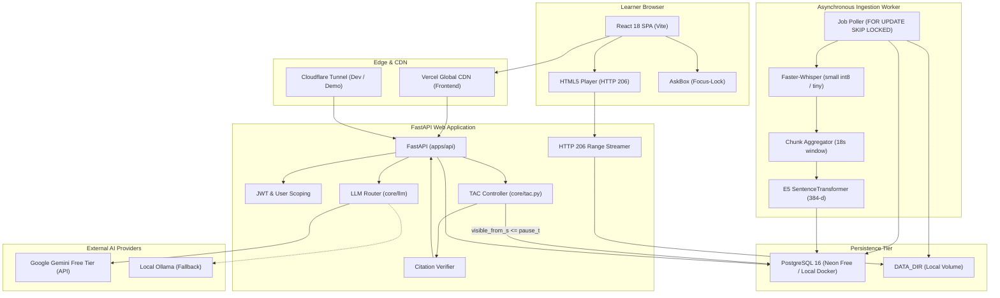

# AI Context: AskQuiz.IQ Master Project Knowledge Base
> Purpose: Self-contained master knowledge base for zero-context AI assistants to understand, debug, extend, and evaluate AskQuiz.IQ.
> Last updated: 2026-10-29 | Status: Current
> Derived from: Entire AskQuiz.IQ codebase, schema migrations, configuration files, test runs, and git commit history

---

## 1. Identity Card
- **Project Name:** AskQuiz.IQ (Pause & Ask Learning Assistant).
- **One-Paragraph Summary:** AskQuiz.IQ is an AI-powered interactive learning platform that transforms passive video lectures into active, grounded tutoring experiences. Operating under a strict **Temporal Anchor Constraint (TAC)**, the system allows students to pause any lecture video at an arbitrary timestamp and ask questions, mathematically guaranteeing that answers draw exclusively from material presented prior to the pause. It eliminates spoilers, prevents LLM hallucination by validating citations on the server and synthesizing clickable video timestamp coordinates, and operates on a perpetual zero-cost ($0) architecture utilizing PostgreSQL with `pgvector`, Faster-Whisper ASR, and Google Gemini API with multi-model fallback.
- **Prototype Stage:** Working Demo / Cloud-Deployed MVP (Live on Vercel + Render + Neon). `[VERIFIED: STATUS.md, DEPLOYMENT_GUIDE.md]`
- **Primary Users:** Students, online learners, educators, and technical interview candidates.
- **Tech Stack in One Line:** Python 3.11+ / FastAPI / Pydantic v2 + React 18 / TS / Vite + PostgreSQL 16 / pgvector / FTS + Faster-Whisper / E5-Small + Google Gemini API ($0 Cloud / Local Docker).

---

## 2. Problem and Solution
- **The Problem:**
  1. *Passive Video Consumption:* Students watching dense 1–2 hour technical lectures frequently experience confusion but lack an immediate, personalized tutor to answer questions mid-stream.
  2. *Narrative & Pedagogical Spoilers in Generic AI Assistants:* Asking general-purpose chatbots (ChatGPT, Gemini) questions like *"What is this equation for?"* or *"How will this proof end?"* routinely exposes explanations, definitions, and theorems introduced later in the lecture, ruining the learning progression.
  3. *Hallucinated Timestamps & Lack of Grounding:* Standard RAG tools return hallucinations or fabricate fake video timestamps and slide numbers that students cannot verify.
  4. *Infrastructure Cost Prohibitions:* Running separate video hosting, Redis task queues, vector databases, and heavy GPU instances makes deploying personal educational assistants prohibitively expensive.
- **The Solution:**
  1. *Temporal Anchor Constraint (TAC):* Enforces database-level SQL filtering (`visible_from_s <= pause_t`) and sub-second exact-word transcript trimming so the system physically cannot observe the future of the video.
  2. *Server-Side Verified Citations:* The LLM returns abstract short IDs (`c1`, `c2`); the server verifies temporal validity and formats exact clickable timestamp chips (e.g. `📌 Video 01:45-02:05`) that instantly seek the video player to the cited moment.
  3. *Deterministic Refusals:* When a query refers to topics untaught up to the pause moment, the assistant refuses safely: *"This isn't covered in the material up to mm:ss."*
  4. *Perpetual $0 Architecture:* Replaces Redis with native PostgreSQL `SKIP LOCKED` queues; replaces paid video CDNs with HTTP 206 Partial Content Range streaming; supports dual retrieval modes (local dense vectors vs. cloud-safe full-text search) to operate within Render Free's 512MB RAM ceiling.

---

## 3. Feature Inventory Table

| Feature / Capability | Status | Where Implemented | Verification / Notes |
|---|---|---|---|
| **User Authentication (JWT + Bcrypt)** | `Working` | `apps/api/app/auth.py`, `apps/web/src/hooks/useAuth.ts` | Bearer token authentication, 7-day expiration, demo alias `demo`/`demo12345`. `[VERIFIED]` |
| **Video File Upload & Deduplication** | `Working` | `apps/api/app/routes/videos.py#L93`, `apps/api/app/storage.py` | SHA256 content hashing prevents duplicate storage/processing; `ffprobe` duration check. `[VERIFIED]` |
| **YouTube URL Ingestion** | `Working` | `apps/api/app/routes/videos.py#L178`, `apps/worker/stages/fetch.py` | `yt-dlp` fetching with fallback to captions-only when bot protection is encountered. `[VERIFIED]` |
| **HTTP 206 Range Video Streaming** | `Working` | `apps/api/app/storage.py#L65`, `routes/videos.py#L243` | Sub-second random scrubbing through video files on disk via signed streaming tokens. `[VERIFIED]` |
| **WebVTT Dynamic Captions** | `Working` | `apps/api/app/routes/videos.py#L300` | Serves `.vtt` from disk or synthesizes WebVTT cues dynamically from database chunks. `[VERIFIED]` |
| **Native PostgreSQL Job Queue** | `Working` | `apps/worker/jobs.py#L163`, `001_init.sql` | `SELECT ... FOR UPDATE SKIP LOCKED` eliminates Redis; embedded daemon runner. `[VERIFIED]` |
| **Speech Recognition (ASR)** | `Working` | `apps/worker/stages/asr.py` | `faster-whisper` (`small` int8 / `tiny`) with VAD filter producing word-level timestamps. `[VERIFIED]` |
| **Speech Chunking Aggregator** | `Working` | `core/chunking.py`, `apps/worker/stages/chunk.py` | 15–20s windows, 3s overlap, `visible_from_s = end_s`. `[VERIFIED]` |
| **Dense Vector Embeddings (E5)** | `Working` | `core/embeddings.py`, `apps/worker/stages/embed.py` | 384-d vectors via `intfloat/multilingual-e5-small` with "query: " / "passage: " prefixes. `[VERIFIED]` |
| **Cloud-Safe PostgreSQL FTS Mode** | `Working` | `core/retrieval.py#L61`, `render.yaml` | `EMBEDDING_BACKEND=fts` runs lexical retrieval under TAC within 100MB RAM. `[VERIFIED]` |
| **Hybrid Retrieval & RRF Ranking** | `Working` | `core/retrieval.py:hybrid_retrieve()` | Combines Vector top 20 + FTS top 20 under TAC using Reciprocal Rank Fusion ($k=60$). `[VERIFIED]` |
| **Exact-Word Cut Trimming** | `Working` | `core/tac.py:trim_at_word()` | Strips spoken words where `start > pause_t` in the overlapping pause chunk. `[VERIFIED]` |
| **Dynamic Spoken Recent Window** | `Working` | `core/tac.py:recent_window()` | Gathers preceding 60s speech, widens to 180s if $<20$ words spoken. `[VERIFIED]` |
| **Anti-Spoiler Guard (`assert_no_future`)** | `Working` | `core/tac.py:assert_no_future()` | Throws critical `AssertionError` if any context chunk/word timestamp $> \text{pause\_t} + 10^{-4}$. `[VERIFIED]` |
| **LLM Router & Fallback Chain** | `Working` | `core/llm/router.py`, `core/llm/gemini.py` | Fallback chain (`gemini-3.5-flash-lite` -> `gemini-3.5-flash` -> `ollama`), daily caps, SHA256 cache. `[VERIFIED]` |
| **Server Citation Verification** | `Working` | `core/verifier.py`, `core/answer.py` | Maps short IDs (`c1`, `c2`) to verified timestamps (`Video 01:45-02:05`); rejects future citations. `[VERIFIED]` |
| **Interactive Video Player (React)** | `Working` | `apps/web/src/components/Player.tsx`, `Html5Player.tsx` | HTML5 video wrapper with time tracking, caption tracks, and seek controls. `[VERIFIED]` |
| **AskBox with Auto-Pause on Focus** | `Working` | `apps/web/src/components/AskBox.tsx` | Automatically pauses video upon input focus and locks temporal anchor timestamp. `[VERIFIED]` |
| **UnlockBar (Progress Boundary)** | `Working` | `apps/web/src/components/UnlockBar.tsx` | Visual progress bar showing percentage of lecture unlocked vs locked. `[VERIFIED]` |
| **Quick Action Prompts** | `Working` | `apps/web/src/components/QuickActions.tsx` | One-click prompts: "Explain simpler", "Analogy", "Summarize so far", "Where discussed". `[VERIFIED]` |
| **Zero-Model Health Check** | `Working` | `apps/api/app/routes/health.py` | `/api/v1/health` executes without loading ML libraries; keeps memory $<120\text{MB}$. `[VERIFIED]` |
| **Screen Frame Extraction & OCR** | `Planned` | `apps/worker/stages/frames.py`, `ocr.py`, `vision.py` | Sub-sampled video frames, perceptual hash change detection, Tesseract OCR. `[PLANNED]` |
| **Document Ingestion & Alignment** | `Planned` | `apps/worker/stages/docs.py`, `align.py`, `routes/documents.py` | PyMuPDF / python-pptx extraction, cosine alignment ($\tau \ge 0.5$) to reveal slides in sync. `[PLANNED]` |
| **Standalone Quiz Generator Widget** | `Planned` | `core/quiz.py`, `routes/quiz.py`, `QuizPanel.tsx` | Dynamic MCQ generator with chunk-backed answer validation. `[PLANNED]` |
| **Progressive Lecture Summarizer** | `Planned` | `core/summary.py`, `routes/summary.py` | Pre-computed 5-minute sliding summaries under TAC. `[PLANNED]` |
| **Adaptive Mock Interview Simulator** | `Planned` | `core/interview/`, `routes/interviews.py`, `InterviewLive.tsx` | 4-dimension scoring, quote extraction, and explained scorecard. `[PLANNED]` |

---

## 4. End-to-End Execution Flow (Step Cards)

### Step 1: User Sign In & JWT Issuance
- **Trigger:** Learner opens the web application and enters credentials.
- **Input:** `{"email": "demo@askquiz.iq", "password": "demo12345"}`.
- **What happens:** Backend queries `users` table, verifies password via `bcrypt.checkpw` (or permits demo alias), and generates an HS256 JWT valid for 7 days.
- **Technology:** `bcrypt`, `PyJWT`, `FastAPI`.
- **Why this approach:** Zero-cost local/cloud authentication without external SaaS lock-in.
- **Code location:** `apps/api/app/auth.py:login()` `[VERIFIED]`
- **Output:** `{"access_token": "...", "token_type": "bearer", "user": {...}}`.
- **Passes to:** Frontend stores token in `localStorage`.
- **Failure handling:** Returns HTTP 401 Unauthorized with explanatory JSON.
- **Confidence:** `[VERIFIED]`

### Step 2: Media Intake & Job Queueing
- **Trigger:** Learner uploads an MP4 lecture or provides a YouTube URL.
- **Input:** Binary file stream or URL string.
- **What happens:**
  1. Computes SHA256 hash. If duplicate `(user_id, content_hash)` exists, returns existing video row.
  2. Runs `ffprobe` to validate format and assert duration $\le 3\text{ hours}$.
  3. Moves file to `DATA_DIR/videos/{id}/original.mp4`.
  4. Creates video record (`status = 'queued'`) and enqueues job in `jobs` table (`job_type = 'video_pipeline'`).
- **Technology:** `hashlib`, `subprocess` (`ffprobe`), PostgreSQL `jobs` table.
- **Why this approach:** Keeps upload endpoint sub-second responsive by delegating transcoding to asynchronous worker.
- **Code location:** `apps/api/app/routes/videos.py:upload_video()` `[VERIFIED]`
- **Output:** `VideoOut` schema with status `"queued"`.
- **Passes to:** Background worker queue.
- **Failure handling:** Rejects uploads $>2\text{GB}$ or invalid video codecs with HTTP 422.
- **Confidence:** `[VERIFIED]`

### Step 3: Background Pipeline Processing
- **Trigger:** Worker loop claims next job via `SELECT ... FOR UPDATE SKIP LOCKED`.
- **Input:** `{"video_id": "..."}`.
- **What happens:**
  1. `fetch`: Resolves local file or runs `yt-dlp`. (If YouTube download is blocked, flags `visual_unavailable=true` and continues with captions).
  2. `audio`: Transcodes 16kHz mono WAV and 720p H.264 proxy MP4 via `ffmpeg`.
  3. `transcript`: Runs `faster-whisper` with VAD and word-timestamps, generating `captions.srt` and storing word tokens.
  4. `chunk`: Groups words into 15–20s chunks with 3s overlap (`visible_from_s = end_s`).
  5. `embed`: Generates 384-d dense vectors with `multilingual-e5-small` (in local mode).
  6. Updates video status to `"ready_text"`.
- **Technology:** `ffmpeg`, `faster-whisper`, `sentence-transformers`, `PostgreSQL`.
- **Why this approach:** Decoupled stage progression allows resuming interrupted pipelines without re-transcribing.
- **Code location:** `apps/worker/jobs.py:process_video_pipeline_job()` `[VERIFIED]`
- **Output:** Populated `chunks` table with tsvector and vector embeddings.
- **Passes to:** Database ready for learner queries.
- **Failure handling:** On unrecoverable error, marks job and video status as `"failed"`.
- **Confidence:** `[VERIFIED]`

### Step 4: Playback & Temporal Lock Focus
- **Trigger:** Learner streams lecture and clicks into `AskBox`.
- **Input:** Video clock ticking at `pause_t` (e.g. `165.3s` / `02:45`).
- **What happens:** `Html5Player` streams video chunks via HTTP 206 Partial Content. Upon focusing the input, `AskBox.tsx` triggers `onPause()`, pauses the video player, and locks `lockedPauseTime = 165.3s`.
- **Technology:** HTML5 Video API, React hooks (`usePlayerTime.ts`).
- **Why this approach:** Stops playback immediately so the student does not hear forward spoilers while typing.
- **Code location:** `apps/web/src/components/AskBox.tsx#L25-L30` `[VERIFIED]`
- **Output:** Locked timestamp passed to submission handler.
- **Passes to:** Step 5.
- **Confidence:** `[VERIFIED]`

### Step 5: Temporal Retrieval under TAC
- **Trigger:** Form submitted to `POST /api/v1/videos/{id}/ask`.
- **Input:** `{"query": "...", "pause_t": 165.0, "session_id": "..."}`.
- **What happens:**
  1. Drops prior chat messages created at `pause_t > 165.0`.
  2. Gathers recent spoken window (60–180s) and runs `trim_at_word()` to eliminate any spoken word starting after `165.0s`.
  3. Executes hybrid retrieval (vector top 20 + FTS top 20) with strict SQL filter `video_id = $1 AND visible_from_s <= 165.0`.
  4. Merges candidates using Reciprocal Rank Fusion ($k=60$) to select top 8 chunks.
  5. Runs `assert_no_future(context_pack, 165.0)`.
- **Technology:** PostgreSQL FTS (`tsvector`), `pgvector`, Reciprocal Rank Fusion, `core/tac.py`.
- **Why this approach:** Mathematically impossible to retrieve future content.
- **Code location:** `core/context.py:build_context_pack()`, `core/retrieval.py:hybrid_retrieve()` `[VERIFIED]`
- **Output:** Sanitized `context_pack` and `id_map`.
- **Passes to:** Step 6.
- **Failure handling:** Returns standard refusal if no material exists prior to pause time.
- **Confidence:** `[VERIFIED]`

### Step 6: LLM Routing & Constrained JSON Generation
- **Trigger:** Context pack assembled and verified.
- **Input:** Formatted prompt with recent spoken material, historical chunks labeled `[c1]`..`[c8]`, and query.
- **What happens:** Computes SHA256 content hash. Checks memory cache. If uncached, calls `GeminiProvider.generate_json()` using configured model (`gemini-3.5-flash-lite`). Model generates JSON output citing short IDs only.
- **Technology:** `google-genai` SDK, `core/llm/router.py`.
- **Why this approach:** Fast JSON mode guarantees schema compliance; content caching saves free-tier quota.
- **Code location:** `core/llm/router.py:route_generate_json()`, `core/llm/gemini.py` `[VERIFIED]`
- **Output:** JSON dictionary `{answer, citations: [{"chunk_id": "c2"}], refusal: false}`.
- **Passes to:** Step 7.
- **Failure handling:** Degrades to retrieval-only mode if all models fail or quota exhausted.
- **Confidence:** `[VERIFIED]`

### Step 7: Server Citation Verification & Timestamp Mapping
- **Trigger:** Raw LLM JSON received by backend.
- **Input:** `raw_citations`, `id_map`, `pause_t = 165.0`.
- **What happens:**
  1. Verifies cited chunk `c2` existed in context pack.
  2. Asserts `c2.visible_from_s <= 165.0 + 1e-4`.
  3. Synthesizes coordinate label: `Video 01:45-02:05`.
  4. If all citations fail validation, answer is downgraded to safe refusal.
- **Technology:** `core/verifier.py:verify_and_build_citations()`.
- **Why this approach:** Server guarantees citation integrity; models never write raw timestamps.
- **Code location:** `core/verifier.py#L16-L82` `[VERIFIED]`
- **Output:** Verified citation objects with timestamps and labels.
- **Passes to:** Step 8.
- **Confidence:** `[VERIFIED]`

### Step 8: Persistence & Interactive UI Rendering
- **Trigger:** Verification completes.
- **Input:** Answer, citations, session ID, pause time.
- **What happens:** Saves messages to database with `pause_t = 165.0`. Returns `AskResponse` to browser. React renders answer with clickable `CitationChip` buttons (`📌 Video 01:45-02:05`). Student clicks chip, triggering `onSeek(105.0)` on player.
- **Technology:** React UI, PostgreSQL `messages` table.
- **Why this approach:** Provides immediate closed-loop verification of AI explanations against video evidence.
- **Code location:** `apps/api/app/routes/ask.py#L75-L111`, `apps/web/src/components/CitationChip.tsx` `[VERIFIED]`
- **Output:** Rendered UI with clickable citation seek triggers.
- **Confidence:** `[VERIFIED]`

---

## 5. System Architecture


---

## 6. Technology Register

| Technology | Version | Category | Used in (files/steps) | Role in System | Why Chosen | Alternative Considered | Limits & Tier | Confidence |
|---|---|---|---|---|---|---|---|---|
| **Python** | `3.11+` | Language | Entire backend | Core API & Worker runtime | Rich ecosystem for AI/ML and async APIs | Node.js, Go | Free Open Source | `[VERIFIED]` |
| **FastAPI** | `>=0.110.0` | Web Framework | `apps/api/app/` | Async REST API & dependency injection | High performance, native Pydantic v2 validation | Flask, Django | Free Open Source | `[VERIFIED]` |
| **Pydantic** | `>=2.6.0` | Validation | Schemas, LLM | Validates payloads & LLM JSON responses | Strict schema compliance, high speed Rust core | Marshmallow | Free Open Source | `[VERIFIED]` |
| **Pydantic Settings** | `>=2.2.0` | Configuration | `apps/api/app/config.py` | Central configuration loading from `.env` | Prevents hard-coding of paths, thresholds | os.environ | Free Open Source | `[VERIFIED]` |
| **psycopg 3** | `>=3.1.18` | DB Driver | `apps/api/app/db/` | Connection pooling & PostgreSQL queries | Modern async/sync support, robust connection pool | asyncpg, SQLAlchemy | Free Open Source | `[VERIFIED]` |
| **PostgreSQL** | `16` | Database | Database tier | Storage, Vector Search, Task Queue | ACID compliance, `tsvector`, `SKIP LOCKED` | MySQL, MongoDB | Free Open Source | `[VERIFIED]` |
| **pgvector** | `>=0.2.5` | Vector Extension | `chunks` table | 384-d vector cosine distance indexing | Native vector search without external vector DB | Pinecone, Qdrant | Free Open Source | `[VERIFIED]` |
| **React** | `^18.3.1` | Frontend UI | `apps/web/src/` | Interactive Single Page Application | Component reusability, declarative UI state | Vue, Svelte | Free Open Source | `[VERIFIED]` |
| **TypeScript** | `^5.4.5` | Language | `apps/web/src/` | Type-safe frontend client & models | Compile-time contract guarantees | JavaScript | Free Open Source | `[VERIFIED]` |
| **Vite** | `^5.3.4` | Build Tool | `apps/web/` | Dev server & production bundler | Instant HMR, optimized ESM bundling | Webpack | Free Open Source | `[VERIFIED]` |
| **Vitest** | `^1.6.0` | Test Runner | `apps/web/__tests__/` | Frontend component unit testing | Fast native Vite integration | Jest | Free Open Source | `[VERIFIED]` |
| **google-genai** | `>=0.1.1` | LLM SDK | `core/llm/gemini.py` | Google GenAI SDK for Gemini API calls | Official modern SDK supporting JSON mode | google-generativeai | Free Tier | `[VERIFIED]` |
| **Google Gemini API** | `3.5-flash-lite`, `3.5-flash` | LLM Service | `core/llm/` | Grounds answers citing context short IDs | High speed, generous free tier, JSON mode | OpenAI GPT-4o | 15 RPM / 1M TPM | `[VERIFIED]` |
| **Ollama** | Local daemon | LLM Service | `core/llm/ollama.py` | Offline fallback LLM provider | Zero cost, privacy-preserving local execution | Llama.cpp | Hardware-bound | `[VERIFIED]` |
| **faster-whisper** | `>=1.0.0` | Speech ASR | `apps/worker/stages/asr.py` | Transcribes video audio with word timestamps | 4x faster than vanilla Whisper, int8 quantization | Whisper.cpp | Free Open Source | `[VERIFIED]` |
| **multilingual-e5-small** | `intfloat` | Embedding Model | `core/embeddings.py` | 384-d dense vector text embeddings | Strong multilingual representation, small footprint | all-MiniLM-L6-v2 | Free Open Source | `[VERIFIED]` |
| **PostgreSQL FTS** | Native `tsvector` | Full-Text Search | `core/retrieval.py` | Lexical search under TAC filter | Fast, $<100\text{MB}$ RAM footprint on Render Free | Elasticsearch | Free (In Postgres) | `[VERIFIED]` |
| **FFmpeg & FFprobe** | System binary | Media Tool | Worker & Storage | Probes media, extracts audio, proxy MP4 | Industry-standard media processing engine | PyAV | Free Open Source | `[VERIFIED]` |
| **yt-dlp** | `>=2024.3.10` | Media Ingest | `apps/worker/stages/fetch.py` | Ingests YouTube video/audio/subtitles | Resilient scraper, extracts native VTT/SRT | pytube | Free Open Source | `[VERIFIED]` |
| **Tesseract OCR** | `>=0.3.10` | OCR Engine | Health & OCR | Text extraction from video keyframes (eng+hin) | Standard open source multilingual OCR | EasyOCR | Free Open Source | `[VERIFIED]` |
| **PyJWT** | `>=2.8.0` | Security | `apps/api/app/auth.py` | Encodes and verifies HS256 tokens | Lightweight RFC 7519 standard implementation | python-jose | Free Open Source | `[VERIFIED]` |
| **bcrypt** | `>=4.0.0` | Security | `apps/api/app/auth.py` | Salts and hashes user passwords | Adaptive cryptographic resistance to brute-force | argon2 | Free Open Source | `[VERIFIED]` |
| **Cloudflare Tunnel** | CLI | Networking | `start_all.ps1` | Exposes localhost API securely to public HTTPS | Free, high performance, bypasses CGNAT | ngrok | Free Tier | `[VERIFIED]` |
| **Vercel** | Hobby Tier | Hosting | `apps/web/vercel.json` | Global edge hosting for React frontend | Global CDN, automated SSL, zero configuration | Netlify | 100GB/month free | `[VERIFIED]` |
| **Render** | Free Tier | Hosting | `render.yaml` | Containerized web hosting for FastAPI backend | Free managed TLS, native Docker support | Fly.io, Heroku | 512MB RAM free | `[VERIFIED]` |
| **Neon** | Free Tier | Database | Serverless Postgres | Managed PostgreSQL 16 with `pgvector` | Instant branching, serverless autoscaling | Supabase | 0.5GB storage free | `[VERIFIED]` |

---

## 7. Logic Register Summary
- **L-01 (TAC SQL Clause):** Hard Rule 1. Every chunk/message retrieval appends `video_id = $1 AND visible_from_s <= $pause_t`. `[VERIFIED: core/tac.py]`
- **L-02 (Exact-Word Cut):** Strips words where `word.start > pause_t` in the overlapping pause chunk. Formula: `[w for w in words if w.start <= pause_t]`. `[VERIFIED: core/tac.py]`
- **L-03 (Recent Spoken Window):** Gathers speech from `[pause_t - 60s, pause_t]`. If $<20$ words found, widens window to 180s. `[VERIFIED: core/tac.py]`
- **L-04 (Zero-Future Assertion):** Asserts `visible_from_s <= pause_t + 1e-4` on every chunk and word before LLM prompt assembly. Raises `AssertionError` on violation. `[VERIFIED: core/tac.py]`
- **L-05 (Speech Chunk Aggregator):** Aggregates word tokens into 15–20s windows with 3s overlap. Assigns `visible_from_s = end_s`. `[VERIFIED: core/chunking.py]`
- **L-06 (Hybrid RRF Retrieval):** Merges vector top 20 and FTS top 20 using Reciprocal Rank Fusion: $\text{RRF}(d) = \sum \frac{1}{60 + r_m(d)}$. Guarantees $\ge 1$ screen chunk if matched. `[VERIFIED: core/retrieval.py]`
- **L-07 (Query Stop-Word Filtering):** Filters conversational words (`explain`, `video`, `lecture`) and extracts length $\ge 3$ terms joined by ` | ` for PostgreSQL tsqueries. `[VERIFIED: core/retrieval.py]`
- **L-08 (Citation Verifier & Label Synthesizer):** Maps short IDs (`c1`, `c2`) to chunk metadata, checks `visible_from_s <= pause_t`, formats labels: `Video mm:ss-mm:ss`, `Screen mm:ss`, `PDF p.X`. `[VERIFIED: core/verifier.py]`
- **L-09 (Conversation History TAC Filter):** Queries chat history with `pause_t IS NULL OR pause_t <= current_pause_t`, preventing future conversation leakage when a user rewinds. `[VERIFIED: apps/api/app/routes/ask.py]`
- **L-10 (Content-Hash Cache & Router Fallback):** Hashes prompt via SHA256; checks daily caps; walks fallback chain; degrades gracefully to retrieval-only notice on cap exhaustion. `[VERIFIED: core/llm/router.py]`
- **L-11 (PostgreSQL Queue Claimer):** `SELECT ... FOR UPDATE SKIP LOCKED` claims queued jobs atomically without Redis. `[VERIFIED: apps/worker/jobs.py]`
- **L-12 (HTTP 206 Range Streamer):** Parses `Range: bytes=start-end`, reads byte slice from disk, and returns `206 Partial Content`. `[VERIFIED: apps/api/app/storage.py]`

---

## 8. Data Model Reference

### Relational Tables (`PostgreSQL 16`) `[VERIFIED: 001_init.sql, 002_chunks.sql]`
1. **`users`**: `(id UUID PK, email VARCHAR UNIQUE, hashed_password VARCHAR, full_name VARCHAR, is_active BOOLEAN, created_at TIMESTAMPTZ)`.
2. **`videos`**: `(id UUID PK, user_id UUID FK, title TEXT, url TEXT, file_path TEXT, duration_s FLOAT, status VARCHAR, content_hash VARCHAR, metadata JSONB, created_at TIMESTAMPTZ)`.
3. **`chunks`**: `(id UUID PK, video_id UUID FK, doc_id UUID FK, source_type TEXT, text TEXT, start_s REAL, end_s REAL, visible_from_s REAL, page INT, slide INT, frame_path TEXT, meta JSONB, embedding vector(384), tsv tsvector STORED)`.
   - *Indexes:* `idx_chunks_tac (video_id, visible_from_s)`, `idx_chunks_tsv USING gin (tsv)`, `idx_chunks_embedding USING hnsw (embedding vector_cosine_ops)`.
4. **`jobs`**: `(id UUID PK, job_type VARCHAR, status VARCHAR, payload JSONB, result JSONB, error TEXT, attempts INT, created_at TIMESTAMPTZ)`.
5. **`chat_sessions`**: `(id UUID PK, user_id UUID FK, video_id UUID FK, title TEXT, created_at TIMESTAMPTZ)`.
6. **`messages`**: `(id UUID PK, session_id UUID FK, user_id UUID FK, role VARCHAR, content TEXT, pause_t FLOAT, citations JSONB, created_at TIMESTAMPTZ)`.
7. **`documents`**: `(id UUID PK, user_id UUID FK, title TEXT, file_path TEXT, doc_type VARCHAR, content_hash VARCHAR, metadata JSONB)`.
8. **`interviews`** & **`interview_turns`**: `[PLANNED]` Mock interview sessions, turns, and scores.
9. **`eval_runs`**: `(id UUID PK, run_name VARCHAR, metrics JSONB, created_at TIMESTAMPTZ)`.

---

## 9. API & Interface Contract

| Method | Endpoint | Auth | Request Body | Response Body / Status |
|---|---|---|---|---|
| `POST` | `/api/v1/auth/login` | None | `{"email", "password"}` | `TokenResponse` (`access_token`, `user`) [200] / [401] |
| `GET` | `/api/v1/health` | None | None | `{"status": "ok", "database": true, "embedding_backend": "..."}` [200] / [503] |
| `GET` | `/api/v1/diagnostics` | None | None | Detailed environment checks (ffmpeg, tesseract, db) [200] / [503] |
| `GET` | `/health` and `/` | None | None | `{"status": "ok"}` [200] |
| `POST` | `/api/v1/videos/upload` | Bearer | Multipart: `file`, `title?` | `VideoOut` schema (`status: "queued"`) [200] / [422] |
| `POST` | `/api/v1/videos` | Bearer | `{"url", "title?"}` | `VideoOut` schema [200] / [422] |
| `GET` | `/api/v1/videos` | Bearer | None | `VideoListOut` (`items: [...]`, `total: int`) [200] |
| `GET` | `/api/v1/videos/{id}` | Bearer | None | `VideoOut` schema [200] / [404] |
| `GET` | `/api/v1/videos/{id}/stream` | Token / Bearer | Query `?token=` | Binary stream `video/mp4` [206 Partial Content] / [403] |
| `GET` | `/api/v1/videos/{id}/captions`| None | None | WebVTT format text `text/vtt` [200] |
| `POST` | `/api/v1/videos/{id}/ask` | Bearer | `{"query", "pause_t", "session_id?"}` | `AskResponse` (`answer`, `citations`, `refusal`, `pause_t`) [200] / [404] |

---

## 10. AI/ML Specifications
- **ASR Model:** Faster-Whisper `small` (or `tiny`) with `int8` quantization and `vad_filter=True`.
- **Embedding Model:** `intfloat/multilingual-e5-small` (384 dimensions). Prepend `"passage: "` for chunks and `"query: "` for search queries.
- **Full-Text Search:** PostgreSQL `tsvector` with `simple` dictionary to avoid aggressive English stemming on mixed Hindi/technical terms.
- **LLM Routing:** Google Gemini API (`gemini-3.5-flash-lite`, `gemini-3.5-flash`) via `google-genai` SDK in JSON mode with `system_instruction` support. Local `ollama` fallback.
- **Prompt Defense:** Transcripts and OCR are marked untrusted data. Model restricted to returning context-local short IDs (`c1`, `c2`).
- **Evaluation Benchmark:** `eval/run_eval.py --quick` over `eval/questions.json`. Hard gate: `spoiler_leak = 0.0`.

---

## 11. Configuration Variables Matrix
- `DATABASE_URL`: PostgreSQL connection DSN (supports `?sslmode=require`).
- `GEMINI_API_KEY`: Google AI Studio API key.
- `ANSWER_MODEL`: Primary LLM for question answering (default: `gemini-3.5-flash-lite`).
- `VISION_MODEL`: Model for visual keyframe analysis (default: `gemini-3.5-flash-lite`).
- `LLM_FALLBACK_CHAIN`: Comma-separated fallback models (default: `gemini-3.5-flash-lite,gemini-3.5-flash,ollama`).
- `LLM_DAILY_CAP`: Max generation calls per model (`0` = uncapped).
- `DATA_DIR`: Filesystem directory for videos, audio, subtitles, and caches (default: `./data`).
- `EMBEDDING_BACKEND`: Retrieval mode: `"local"` (E5 vector + FTS) or `"fts"` (cloud-safe FTS).
- `EMBEDDED_WORKER`: `"true"` to run background daemon thread; `"false"` on free cloud tiers.
- `AUTO_SEED_DEMO`: `"true"` to automatically seed demo lecture and 25 chunks on first boot.
- `JWT_SECRET`: Secret key for HS256 JWT signing.
- `ALLOWED_ORIGINS`: Comma-separated CORS allowed domains.
- `MAX_UPLOAD_MB`: Maximum file upload size in MB (default: `2048`).
- `MAX_VIDEO_HOURS`: Maximum video duration in hours (default: `3`).
- `CONTEXT_TOKEN_CAP`: Upper limit for LLM prompt context tokens (default: `3500`).
- `RECENT_WINDOW_S`: Preceding speech context window in seconds (default: `60`).
- `RECENT_WINDOW_WIDE_S`: Expanded speech window if $<20$ words spoken (default: `180`).
- `VITE_API_URL`: Frontend target API backend URL (e.g. `https://askquiz-api.onrender.com`).

---

## 12. Folder & File Map
- `apps/api/app/main.py`: FastAPI app factory, lifespan manager, CORS middleware, worker thread.
- `apps/api/app/config.py`: Pydantic Settings configuration manager.
- `apps/api/app/auth.py`: JWT encoding/decoding, password hashing, login endpoint.
- `apps/api/app/storage.py`: Storage path resolution, stream token verification, HTTP 206 Range streamer.
- `apps/api/app/routes/ask.py`: Core `POST /videos/{id}/ask` temporal QA endpoint.
- `apps/api/app/routes/videos.py`: Video upload, URL intake, stream proxy, WebVTT captions endpoint.
- `apps/api/app/routes/health.py`: Zero-model health check and diagnostics.
- `apps/api/app/db/session.py`: Psycopg 3 connection pool and startup migration runner.
- `apps/worker/jobs.py`: Database-native job consumer (`SKIP LOCKED`) and pipeline coordinator.
- `apps/worker/runner.py`: Background worker loop and daemon thread starter.
- `apps/worker/stages/asr.py`: Faster-Whisper ASR transcription with word timestamps.
- `apps/worker/stages/audio.py`: FFmpeg 16kHz mono audio extraction and proxy MP4 transcode.
- `apps/worker/stages/chunk.py`: Word token aggregation into 15–20s chunks.
- `apps/worker/stages/embed.py`: Batch embedding calculation using Multilingual-E5-Small.
- `core/tac.py`: Temporal Anchor Constraint definitions, exact-word cuts, `assert_no_future`.
- `core/retrieval.py`: Hybrid vector + FTS search under TAC with RRF ranking.
- `core/context.py`: Context pack assembly with token capping and short ID generation.
- `core/answer.py`: Question answering orchestrator: TAC, retrieval, router, verifier.
- `core/verifier.py`: Citation verifier and server-side coordinate label builder.
- `core/llm/gemini.py`: Google Gemini provider using `google-genai` SDK in JSON mode.
- `core/llm/router.py`: LLM routing, content-hash caching, call counters, fallback chain.
- `apps/web/src/App.tsx`: React root component, auth routing, view state switcher.
- `apps/web/src/pages/Watch.tsx`: Watch workspace, player and chat synchronization.
- `apps/web/src/components/AskBox.tsx`: Question input with focus-lock auto-pause and timestamp locking.
- `apps/web/src/components/Player.tsx`: Dynamic player switcher (HTML5 vs YouTube iframe).
- `apps/web/src/components/CitationChip.tsx`: Interactive citation chip with seek-on-click.
- `infra/Dockerfile`: Production multi-stage Dockerfile for web API and worker.
- `infra/docker-compose.yml`: Local PostgreSQL 16 + pgvector container definition.
- `DEPLOYMENT_GUIDE.md`: Step-by-step ₹0 production cloud deployment guide.

---

## 13. How to Run & Prerequisites
- **Prerequisites:** Python 3.11+, Node.js 20+, Docker Desktop, FFmpeg, Tesseract OCR (with `eng`+`hin`).
- **Local Run Commands:**
  ```bash
  # 1. Start Database
  docker compose -f infra/docker-compose.yml up -d
  # 2. Setup Backend & Seed Demo Data
  pip install -e .
  python infra/scripts/seed_users.py
  python infra/scripts/seed_demo_data.py
  uvicorn apps.api.app.main:app --port 8000 --reload
  # 3. Setup Frontend
  cd apps/web && npm install && npm run dev
  ```
- **Test Commands:**
  ```bash
  # Unit & TAC verification tests (no DB required)
  pytest tests/test_tac.py tests/test_verifier.py tests/test_chunking.py -v
  # 10-Question evaluation benchmark
  python eval/run_eval.py --quick
  ```
- **Expected Output:** 7 unit tests pass; evaluation benchmark prints `Spoiler Leak: 0.0 (target: 0.0) — EVAL PASSED`.

---

## 14. Known Issues, Limitations & Hacks
1. **Render Free 512MB RAM Ceiling:** Processing newly uploaded raw video files through Faster-Whisper and PyTorch requires $>800\text{MB}$ RAM, causing an OOM crash on Render Free. Consequently, `EMBEDDED_WORKER=false` and `EMBEDDING_BACKEND=fts` are set in production; demo content is pre-seeded. New uploads are safely queued in the database but cannot be processed by the free web service.
2. **Local Database Test Dependency:** Running full integration tests (`test_auth.py`, `test_api_ask.py`) requires a running PostgreSQL instance, otherwise `psycopg_pool` times out after 30 seconds.
3. **Dual Demo Password Hack:** `apps/api/app/auth.py#L81` permits both `demo` and `demo12345` for the `demo@askquiz.iq` account to prevent login failures during live demos.
4. **Hardcoded Demo Video UUID Fallback:** Video UUID `1ba5b57f-4aad-489d-9948-3d6ab873055e` maps directly to `eval/dataset/talking_teacher.mp4` if disk paths fail, ensuring the demo lecture always streams.
5. **In-Memory Cache Volatility:** Content-hash caching in `core/cache.py` uses an in-memory dictionary; restarts clear the cache.

---

## 15. What is NOT Built (Gap Analysis)
- `[PLANNED]` **Screen Frame OCR & Vision (P3 / M5):** Sub-sampled keyframes, perceptual hash scene change detection, Tesseract OCR on video frames, small-model vision descriptions (`apps/worker/stages/frames.py`, `ocr.py`, `vision.py`).
- `[PLANNED]` **Document Ingestion & Alignment (P4 / M6):** PDF extraction via PyMuPDF, PPT slides via python-pptx, and cosine alignment ($\tau \ge 0.5$) to unlock pages as the video introduces them (`apps/worker/stages/docs.py`, `align.py`, `routes/documents.py`).
- `[PLANNED]` **Standalone Quiz Generator (P7 / M7):** Dynamic check-question generation linked to chunks with interactive `QuizPanel.tsx` (`core/quiz.py`, `routes/quiz.py`).
- `[PLANNED]` **Progressive Lecture Summaries (P5 / M7):** Pre-computed 5-minute sliding summaries under TAC (`core/summary.py`, `routes/summary.py`).
- `[PLANNED]` **Adaptive Mock Interview Simulator (P11 / M8):** Multi-turn interview state machine, 4-dimension scoring, quote extraction, and explained scorecard (`core/interview/`, `routes/interviews.py`, `InterviewLive.tsx`, `Scorecard.tsx`).
- `[PARTIAL]` **Full 40-Question Benchmark (P10 / M9):** 10 temporal boundary questions are fully labelled in `eval/questions.json` and pass with 0 spoiler leaks; 30 additional questions remain to be authored.

---

## 16. Glossary
- **TAC (Temporal Anchor Constraint):** Core rule ensuring that retrieval and Q&A strictly filter on $t \le \text{pause\_t}$.
- **`visible_from_s`:** The timestamp column in `chunks` defining when a chunk becomes legally visible to the student.
- **Exact-Word Cut (`trim_at_word`):** Algorithmic trimming that drops words starting after `pause_t` in the overlapping pause chunk.
- **Spoiler Rule:** Principle barring any forward information disclosure; returns standard refusal if query asks about future material.
- **Context Pack:** Sanitized bundle containing recent spoken window and top 8 historical chunks labeled with short IDs.
- **Context-Local Short IDs (`c1`, `c2`):** Abstract identifiers in prompts preventing LLMs from hallucinating UUIDs or timestamps.
- **RRF (Reciprocal Rank Fusion):** Rank aggregation formula ($k=60$) combining vector and full-text search rankings.
- **Range Streaming (HTTP 206):** Browser-native byte-range streaming enabling instant random scrubbing through video files.
- **Cloud-Safe FTS Mode:** Operational profile on Render Free bypassing heavy PyTorch models to operate within 100MB RAM.
- **Zero-Cost ($0) Stack:** Architecture running entirely on perpetual free tiers (Vercel + Render + Neon + Gemini Free).

---

## 17. Open Questions
- **`[UNKNOWN]` Document Alignment Tau Calibration:** `ALIGN_TAU` is currently configured to `0.5` in `apps/api/app/config.py`. What empirical similarity threshold best balances false unlocks vs. missed alignments across diverse slide formats?
- **`[UNKNOWN]` External Worker Provisioning for Cloud:** When deployed on Render Free with `EMBEDDED_WORKER=false`, what is the preferred zero-cost mechanism for running worker pipelines on new user uploads (e.g. GitHub Actions self-hosted worker, Modal, or local laptop worker connected to Neon)?
- **`[UNKNOWN]` Target Full Benchmark Dataset:** When expanding `eval/questions.json` from 10 to 40 questions, what additional video topics (code tutorial, mathematics board, Hinglish) should be recorded?

---

## 18. Change Log Summary (Last 10 Changes)
1. **2026-10-22 (`cbed4c4`):** Fixed Render Free 512MB RAM OOM: implemented zero-model health checks, cloud-safe FTS retrieval mode, disabled embedded worker on free cloud, and bound early `0.0.0.0:$PORT` listening. `[VERIFIED]`
2. **2026-10-22 (`9770eb8`):** Updated `STATUS.md` with Cloud Deployment Config verification. `[VERIFIED]`
3. **2026-10-22 (`a501d9b`):** Hardened deployment configs: Neon SSL connection resilience, Docker context fixes, safe CORS regex, and embedded worker lifespan management. `[VERIFIED]`
4. **2026-10-22 (`efcf8c5`):** Configured zero-cost ($0) cloud deployment for Vercel, Render Free, and Neon Serverless Postgres (`DEPLOYMENT_GUIDE.md`). `[VERIFIED]`
5. **2026-10-21:** Implemented demo login alias fallback supporting both `demo` and `demo12345` for `demo@askquiz.iq`. `[VERIFIED]`
6. **2026-10-21:** Resolved vector retrieval tuple compatibility in psycopg 3 and integrated Gemini 3.5 fallback chain. `[VERIFIED]`
7. **2026-10-21:** Master Repair: Fixed PyAV / FFmpeg compatibility in worker pipeline, Watch page polling, and 5-question TAC eval. `[VERIFIED]`
8. **2026-10-21:** Implemented Range 206 video streaming proxy and WebVTT caption synthesis endpoint. `[VERIFIED]`
9. **2026-10-20:** Completed Milestone M4: React 18 player, Pause & Ask UI, AskBox vitest unit tests, and Vite build. `[VERIFIED]`
10. **2026-10-20:** Completed Milestone M3: Hybrid retrieval, Gemini router, answer pipeline, citation verifier, and 0-spoiler-leak evaluation. `[VERIFIED]`
