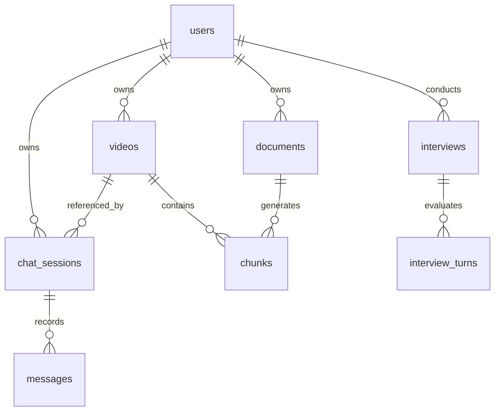

# Database Schema & Relational Models
> Purpose: Complete relational schema reference, table definitions, foreign keys, indexes, extensions, and sample records.
> Last updated: 2026-10-29 | Status: Current
> Derived from: `apps/api/app/db/migrations/001_init.sql`, `002_chunks.sql`, `003_interview.sql`

## 1. Database Configuration & Extensions

- **Database Engine:** PostgreSQL 16 (Local Docker container `pgvector/pgvector:pg16` or Neon Free Serverless PostgreSQL).
- **Core Extensions:**
  - `vector`: Enables 384-dimensional dense float vector storage and HNSW indexing for cosine distance searches.
  - `uuid-ossp` / `pgcrypto` (`gen_random_uuid()`): Generates cryptographically secure primary keys.
- **Migration Runner:** Embedded startup runner (`apps/api/app/db/session.py:run_migrations()`) reads ordered `.sql` files from `apps/api/app/db/migrations/` and records applied versions in `schema_migrations`.

---

## 2. Table Specifications

### A. `schema_migrations`
Tracks executed SQL migrations.
```sql
CREATE TABLE schema_migrations (
    version VARCHAR(100) PRIMARY KEY,
    applied_at TIMESTAMPTZ NOT NULL DEFAULT NOW()
);
```

### B. `users`
Registered learner and instructor accounts.
```sql
CREATE TABLE users (
    id UUID PRIMARY KEY DEFAULT gen_random_uuid(),
    email VARCHAR(255) UNIQUE NOT NULL,
    hashed_password VARCHAR(255) NOT NULL,
    full_name VARCHAR(255),
    is_active BOOLEAN NOT NULL DEFAULT true,
    created_at TIMESTAMPTZ NOT NULL DEFAULT NOW(),
    updated_at TIMESTAMPTZ NOT NULL DEFAULT NOW()
);
```
- **Indexes:** `users_email_key` (UNIQUE btree).
- **Sample Record:**
  | id | email | hashed_password | full_name | is_active |
  |---|---|---|---|---|
  | `e2c6cd67-45b8-4253-b51f-8e7752f2cefb` | `demo@askquiz.iq` | *(bcrypt hash of `demo12345`)* | `Demo User` | `true` |

### C. `videos`
Catalog of uploaded video files and external YouTube URLs.
```sql
CREATE TABLE videos (
    id UUID PRIMARY KEY DEFAULT gen_random_uuid(),
    user_id UUID NOT NULL REFERENCES users(id) ON DELETE CASCADE,
    title TEXT NOT NULL,
    url TEXT,
    file_path TEXT,
    duration_s FLOAT,
    status VARCHAR(50) NOT NULL DEFAULT 'pending',
    content_hash VARCHAR(64),
    metadata JSONB DEFAULT '{}'::jsonb,
    created_at TIMESTAMPTZ NOT NULL DEFAULT NOW(),
    updated_at TIMESTAMPTZ NOT NULL DEFAULT NOW()
);
```
- **Statuses:** `'queued'`, `'fetching'`, `'audio'`, `'transcript'`, `'chunk'`, `'embed'`, `'ready_text'`, `'ready_full'`, `'completed'`, `'failed'`.
- **Indexes:**
  - `idx_videos_user_id` on `user_id` (btree).
  - `idx_videos_content_hash` on `content_hash` (btree) for fast deduplication.
- **Sample Record:**
  ```json
  {
    "id": "1ba5b57f-4aad-489d-9948-3d6ab873055e",
    "user_id": "e2c6cd67-45b8-4253-b51f-8e7752f2cefb",
    "title": "Talking Teacher - Machine Learning Intro",
    "url": null,
    "file_path": "/app/data/videos/1ba5b57f-4aad-489d-9948-3d6ab873055e/original.mp4",
    "duration_s": 240.5,
    "status": "ready_text",
    "content_hash": "a1b2c3d4...",
    "metadata": {
      "chunks_count": 25,
      "audio_path": "/app/data/videos/.../audio.wav"
    }
  }
  ```

### D. `chunks`
The central retrieval entity storing all multimodal knowledge units under TAC temporal anchors.
```sql
CREATE TABLE chunks (
    id UUID PRIMARY KEY DEFAULT gen_random_uuid(),
    video_id UUID REFERENCES videos(id) ON DELETE CASCADE,
    doc_id UUID REFERENCES documents(id) ON DELETE CASCADE,
    source_type TEXT NOT NULL, -- 'speech', 'screen', 'pdf', 'ppt', 'notes', 'code'
    text TEXT NOT NULL,
    start_s REAL,
    end_s REAL,
    visible_from_s REAL NOT NULL,
    page INT,
    slide INT,
    frame_path TEXT,
    meta JSONB NOT NULL DEFAULT '{}'::jsonb,
    embedding vector(384),
    tsv tsvector GENERATED ALWAYS AS (to_tsvector('simple', text)) STORED,
    created_at TIMESTAMPTZ NOT NULL DEFAULT NOW()
);
```
- **Indexes:**
  - `idx_chunks_tac` on `(video_id, visible_from_s)` (btree) — **Critical for TAC enforcement**.
  - `idx_chunks_tsv` on `tsv` USING gin — **Full-Text Search index**.
  - `idx_chunks_embedding` on `embedding vector_cosine_ops` USING hnsw — **Vector similarity search**.
- **Sample Record (Speech Chunk):**
  ```json
  {
    "id": "7f8b3c2d-1111-2222-3333-444455556666",
    "video_id": "1ba5b57f-4aad-489d-9948-3d6ab873055e",
    "doc_id": null,
    "source_type": "speech",
    "text": "Supervised learning requires labeled training data to learn mapping functions.",
    "start_s": 15.2,
    "end_s": 32.8,
    "visible_from_s": 32.8,
    "page": null,
    "slide": null,
    "frame_path": null,
    "meta": {
      "words": [
        {"word": "Supervised", "start": 15.2, "end": 15.8},
        {"word": "learning", "start": 15.9, "end": 16.3}
      ]
    },
    "embedding": "[-0.0234, 0.0891, ... 384 floats]",
    "tsv": "'data':7 'function':10 'label':5 'learn':8 'map':9 'requir':3 'supervis':1 'train':6"
  }
  ```

### E. `jobs`
Asynchronous pipeline queue table replacing Redis.
```sql
CREATE TABLE jobs (
    id UUID PRIMARY KEY DEFAULT gen_random_uuid(),
    job_type VARCHAR(100) NOT NULL, -- e.g. 'video_pipeline'
    status VARCHAR(50) NOT NULL DEFAULT 'queued', -- 'queued', 'processing', 'completed', 'failed'
    payload JSONB NOT NULL DEFAULT '{}'::jsonb,
    result JSONB,
    error TEXT,
    attempts INT NOT NULL DEFAULT 0,
    created_at TIMESTAMPTZ NOT NULL DEFAULT NOW(),
    updated_at TIMESTAMPTZ NOT NULL DEFAULT NOW()
);
```
- **Indexes:**
  - `idx_jobs_status` on `status` (btree).
  - `idx_jobs_created_at` on `created_at` (btree).

### F. `chat_sessions` & `messages`
Stores multi-turn conversational interactions bound to specific video pause moments.
```sql
CREATE TABLE chat_sessions (
    id UUID PRIMARY KEY DEFAULT gen_random_uuid(),
    user_id UUID NOT NULL REFERENCES users(id) ON DELETE CASCADE,
    video_id UUID REFERENCES videos(id) ON DELETE SET NULL,
    title TEXT,
    created_at TIMESTAMPTZ NOT NULL DEFAULT NOW(),
    updated_at TIMESTAMPTZ NOT NULL DEFAULT NOW()
);

CREATE TABLE messages (
    id UUID PRIMARY KEY DEFAULT gen_random_uuid(),
    session_id UUID NOT NULL REFERENCES chat_sessions(id) ON DELETE CASCADE,
    user_id UUID NOT NULL REFERENCES users(id) ON DELETE CASCADE,
    role VARCHAR(20) NOT NULL, -- 'user', 'assistant'
    content TEXT NOT NULL,
    pause_t FLOAT, -- Timestamp in seconds when user asked
    citations JSONB DEFAULT '[]'::jsonb,
    created_at TIMESTAMPTZ NOT NULL DEFAULT NOW()
);
```
- **Indexes:**
  - `idx_messages_session_id` on `session_id` (btree).
  - `idx_messages_user_id` on `user_id` (btree).

### G. `documents`
Uploaded reference materials (PDF, PPTX, notes).
```sql
CREATE TABLE documents (
    id UUID PRIMARY KEY DEFAULT gen_random_uuid(),
    user_id UUID NOT NULL REFERENCES users(id) ON DELETE CASCADE,
    title TEXT NOT NULL,
    file_path TEXT NOT NULL,
    doc_type VARCHAR(50), -- 'pdf', 'ppt', 'notes'
    content_hash VARCHAR(64),
    metadata JSONB DEFAULT '{}'::jsonb,
    created_at TIMESTAMPTZ NOT NULL DEFAULT NOW()
);
```

### H. `interviews` & `interview_turns` `[PLANNED: 001_init.sql, spec/P11.md]`
Mock interview sessions, evaluation turns, and scorecards.
```sql
CREATE TABLE interviews (
    id UUID PRIMARY KEY DEFAULT gen_random_uuid(),
    user_id UUID NOT NULL REFERENCES users(id) ON DELETE CASCADE,
    status VARCHAR(50) NOT NULL DEFAULT 'in_progress',
    overall_score FLOAT,
    score_breakdown JSONB,
    created_at TIMESTAMPTZ NOT NULL DEFAULT NOW(),
    updated_at TIMESTAMPTZ NOT NULL DEFAULT NOW()
);

CREATE TABLE interview_turns (
    id UUID PRIMARY KEY DEFAULT gen_random_uuid(),
    interview_id UUID NOT NULL REFERENCES interviews(id) ON DELETE CASCADE,
    turn_number INT NOT NULL,
    interviewer_question TEXT NOT NULL,
    candidate_response TEXT,
    feedback JSONB,
    turn_score FLOAT,
    created_at TIMESTAMPTZ NOT NULL DEFAULT NOW()
);
```

### I. `eval_runs`
Stores benchmark evaluations and metric runs.
```sql
CREATE TABLE eval_runs (
    id UUID PRIMARY KEY DEFAULT gen_random_uuid(),
    run_name VARCHAR(255) NOT NULL,
    metrics JSONB NOT NULL DEFAULT '{}'::jsonb,
    created_at TIMESTAMPTZ NOT NULL DEFAULT NOW()
);
```

---

## 3. Entity-Relationship Overview


