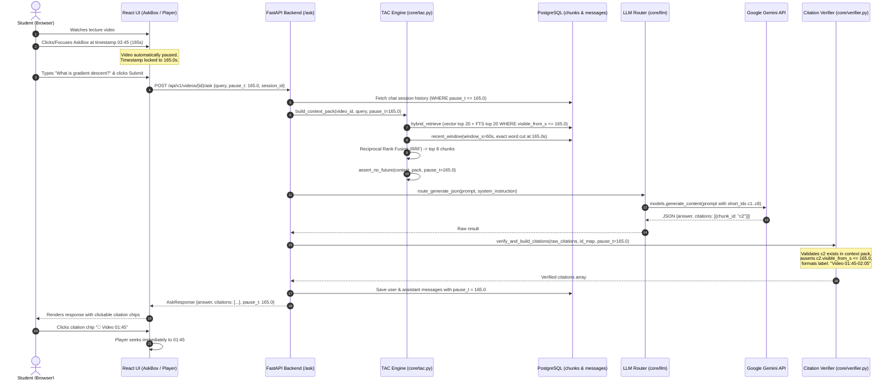

# System Execution Flows & End-to-End Journeys
> Purpose: Detailed, step-by-step walkthrough of all user and asynchronous system flows formatted with complete Step Cards.
> Last updated: 2026-10-29 | Status: Current
> Derived from: `apps/api/app/routes/`, `apps/worker/`, `core/`, `apps/web/src/`

## 1. Primary Flow Overview: Watch, Pause & Temporal Q&A

The core journey of AskQuiz.IQ enables a student to stream an educational video lecture, pause at an arbitrary timestamp, ask a conceptual or clarifying question, and receive an answer derived strictly and exclusively from information presented prior to the pause.



---

## 2. Detailed Step Cards

### Step 1: User Authentication & Session Establishment
- **Trigger:** Learner visits the application root URL or session expires.
- **Input:** JSON payload:
  ```json
  {
    "email": "demo@askquiz.iq",
    "password": "demo12345"
  }
  ```
- **What happens:**
  1. API receives POST request to `/api/v1/auth/login`.
  2. Queries `users` table for matching email (case-insensitive, trimmed).
  3. Validates password via `bcrypt.checkpw` (or permits demo alias `demo`/`demo12345` for `demo@askquiz.iq`).
  4. Encodes a signed HS256 JWT containing user UUID (`sub`) and email, valid for 7 days (`ACCESS_TOKEN_EXPIRE_MINUTES`).
- **Technology used:** `bcrypt` (password hashing), `PyJWT` (token generation), `psycopg 3` (database query).
- **Why this approach:** Replaces complex third-party SaaS auth (e.g. Supabase) with a zero-cost local/cloud JWT implementation that works offline and in Docker.
- **Code location:** `apps/api/app/auth.py:login()` and `verify_password()`.
- **Output:** JSON response:
  ```json
  {
    "access_token": "eyJhbGciOiJIUzI1NiIsIn...",
    "token_type": "bearer",
    "user": {
      "id": "e2c6cd67-45b8-4253-b51f-8e7752f2cefb",
      "email": "demo@askquiz.iq",
      "full_name": "Demo User",
      "is_active": true
    }
  }
  ```
- **Passes to:** Frontend stores token in `localStorage.setItem('askquiz_token')`.
- **Failure handling:** Returns HTTP 401 Unauthorized with `{code: "UNAUTHORIZED", message: "Invalid email or password", hint: "..."}`.
- **Confidence:** `[VERIFIED: apps/api/app/auth.py#L68-L105]`
- **Notes / known issues:** Demo alias supports both `demo` and `demo12345` to prevent onboarding friction during live demos.

---

### Step 2: Video Intake & Asynchronous Ingestion Trigger
- **Trigger:** Learner uploads an MP4 file or submits a YouTube URL via the Upload view.
- **Input:** Multipart form upload (`file: UploadFile`, `title: Optional[str]`) or JSON (`url: str`, `title: Optional[str]`).
- **What happens:**
  1. Streams incoming file into a temporary file while computing SHA256 content hash.
  2. Enforces maximum upload ceiling (`MAX_UPLOAD_MB = 2048`).
  3. Checks `videos` table for duplicate `(user_id, content_hash)`. If match exists, returns existing video immediately.
  4. Probes media duration and format using `ffprobe` subprocess. Rejects if duration > `MAX_VIDEO_HOURS` (3 hours).
  5. Moves file to permanent directory `DATA_DIR/videos/{video_id}/original.mp4`.
  6. Inserts row into `videos` with `status = 'queued'` and inserts row into `jobs` table with `job_type = 'video_pipeline'`.
- **Technology used:** `hashlib.sha256` (deduplication), `subprocess` with `ffprobe` (media validation), `psycopg 3` (relational transactions).
- **Why this approach:** Content hashing prevents duplicate processing of identical videos; background jobs keep the HTTP upload endpoint sub-second responsive.
- **Code location:** `apps/api/app/routes/videos.py:upload_video()` and `create_video_from_url()`.
- **Output:** `VideoOut` schema with status `"queued"` and signed stream URL.
- **Passes to:** Asynchronous worker queue (`jobs` table).
- **Failure handling:** Deletes temporary files if `MAX_UPLOAD_MB` exceeded or `ffprobe` fails with HTTP 422 ValidationError.
- **Confidence:** `[VERIFIED: apps/api/app/routes/videos.py#L93-L176]`

---

### Step 3: Background Worker Ingestion Pipeline
- **Trigger:** Worker loop polls `jobs` table using `SELECT ... FOR UPDATE SKIP LOCKED`.
- **Input:** Job payload `{"video_id": "...", "url": "..."}`.
- **What happens:**
  1. Updates job status to `"processing"` with attempt counter increment.
  2. **Fetch Stage:** If URL provided, downloads stream via `yt-dlp`. If blocked/restricted, marks `visual_unavailable=true` and proceeds with captions.
  3. **Audio Transcoding:** Calls `ffmpeg` to produce 16kHz mono WAV (`audio.wav`) and 720p H.264 faststart MP4 (`proxy.mp4`).
  4. **ASR / Transcription:** Checks for existing SRT/VTT. If absent, runs `faster-whisper` (`small` or `tiny` with int8 compute) with VAD filter to produce word-level timestamps `[{word, start, end}]`. Writes `captions.srt`.
  5. **Chunking Stage:** Calls `chunk_words()` to aggregate words into 15–20s windows with 3s overlap. Assigns `visible_from_s = end_s`.
  6. **Embedding Stage:** If `EMBEDDING_BACKEND=local`, runs `intfloat/multilingual-e5-small` in batches of 32 to populate `chunks.embedding vector(384)`.
  7. Updates `videos` status to `"ready_text"`.
- **Technology used:** `yt-dlp`, `ffmpeg`, `faster-whisper`, `sentence-transformers`, `PostgreSQL pgvector`.
- **Why this approach:** Decoupled stages allow resuming interrupted jobs without repeating expensive transcription or embedding steps.
- **Code location:** `apps/worker/jobs.py:process_video_pipeline_job()`, `apps/worker/stages/asr.py`, `chunk.py`, `embed.py`.
- **Output:** Database populated with speech chunks, embeddings, tsvector full-text indexes, and captions file on disk.
- **Passes to:** Learner can now watch and ask questions.
- **Failure handling:** On error, updates job status to `"failed"` with traceback; video status set to `"failed"` with error detail in JSON metadata.
- **Confidence:** `[VERIFIED: apps/worker/jobs.py#L72-L162]`
- **Notes / known issues:** On Render Free (512MB RAM), heavy worker execution triggers OOM; `EMBEDDED_WORKER=false` and `AUTO_SEED_DEMO=true` are configured to prevent server crash.

---

### Step 4: Video Playback & Temporal Lock Focus
- **Trigger:** Learner clicks a video in the library and clicks/taps into the `AskBox` input.
- **Input:** Player playback clock ticking at current timestamp (e.g. `02:45.3` / `165.3s`).
- **What happens:**
  1. `Html5Player.tsx` plays video through `/api/v1/videos/{video_id}/stream` using HTTP 206 Partial Content range requests.
  2. `usePlayerTime.ts` synchronizes current playback time in state.
  3. When learner focuses the text input in `AskBox.tsx`, `onFocus` calls `onPause()`, immediately pausing video playback.
  4. Locks `lockedPauseTime` to current timestamp (e.g. `165.3`), rendering *"Asking at 02:45"*.
  5. Learner can scrub back/forward or click "Update to now" to re-synchronize before submitting.
- **Technology used:** HTML5 Video API, React hooks (`usePlayerTime`, `useState`).
- **Why this approach:** Focusing the input prevents the learner from watching further ahead while formulating a question, eliminating cognitive drift and accidental future knowledge exposure.
- **Code location:** `apps/web/src/components/AskBox.tsx#L25-L30`, `apps/web/src/hooks/usePlayerTime.ts`.
- **Output:** Locked timestamp integer/float passed to submission handler.
- **Passes to:** Step 5.
- **Failure handling:** If player fails to pause, fallback sends current clock time at moment of form submission.
- **Confidence:** `[VERIFIED: apps/web/src/components/AskBox.tsx#L16-L42]`

---

### Step 5: Temporal Retrieval & Anti-Spoiler Enforcement (TAC)
- **Trigger:** Learner submits question: `POST /api/v1/videos/{video_id}/ask` with `pause_t: 165.0`.
- **Input:**
  ```json
  {
    "query": "What is the loss function used here?",
    "pause_t": 165.0,
    "session_id": "optional-uuid"
  }
  ```
- **What happens:**
  1. **Session & History Fetch:** Fetches chat messages where `pause_t IS NULL OR pause_t <= 165.0`. Drops any future messages from prior turns if the user had scrubbed backward.
  2. **Recent Spoken Window:** `recent_window()` queries speech chunks overlapping `[165.0 - 60s, 165.0]`. Runs `trim_at_word()` to discard any spoken word with `start > 165.0`. If word count < 20, widens window to 180s.
  3. **Candidate Retrieval:**
     - In Local mode: Runs dense vector cosine similarity (top 20) + FTS tsvector search (top 20), filtered by `video_id = $1 AND visible_from_s <= 165.0`. Combines using Reciprocal Rank Fusion (RRF $k=60$) to select top 8 chunks.
     - In Cloud FTS mode: Bypasses vector search completely to prevent loading SentenceTransformer, executes `plainto_tsquery('simple', query)` with OR fallback.
  4. **Context Pack Assembly:** Assigns context-local identifiers (`c1`, `c2`, ...). Limits total context to `CONTEXT_TOKEN_CAP` (3,500 tokens).
  5. **TAC Guard:** Calls `assert_no_future(context_pack, 165.0)`. Asserts no chunk or word has `visible_from_s > 165.0 + 1e-4`.
- **Technology used:** PostgreSQL FTS (`tsvector`), `pgvector` HNSW, Reciprocal Rank Fusion, `core/tac.py`.
- **Why this approach:** Guaranteed zero spoiler leakage through mathematically enforced SQL predicates and runtime memory assertions.
- **Code location:** `apps/api/app/routes/ask.py#L18-L74`, `core/context.py:build_context_pack()`, `core/retrieval.py:hybrid_retrieve()`, `core/tac.py`.
- **Output:** `context_pack` containing sanitized `recent_window` and `chunks`, plus `id_map` for server citation verification.
- **Passes to:** Step 6.
- **Failure handling:** If no context exists prior to `pause_t`, immediately returns standard refusal without invoking LLM: *"This isn't covered in the material up to 02:45."*
- **Confidence:** `[VERIFIED: core/context.py#L12-L83, core/retrieval.py#L48-L186]`

---

### Step 6: LLM Routing & Constrained JSON Generation
- **Trigger:** Context pack assembled and verified by TAC engine.
- **Input:** Formatted prompt including `Current Pause Time: 02:45`, `Recent Spoken Material`, candidate chunks `[c1] ... [c8]`, and user query.
- **What happens:**
  1. Computes SHA256 content hash of `(prompt + system_instruction)`. Checks in-memory cache (`core/cache.py`). If found, returns cached JSON immediately.
  2. Iterates configured fallback chain: `LLM_FALLBACK_CHAIN = gemini-3.5-flash-lite,gemini-3.5-flash,ollama`.
  3. Checks `LLM_DAILY_CAP`. If model exceeded, skips to next model.
  4. Calls `GeminiProvider.generate_json()` using `google-genai` SDK with `response_mime_type="application/json"` and `system_instruction`.
  5. LLM generates factual response citing context short IDs only (e.g. `[{"chunk_id": "c2"}]`).
  6. Increments call counter and stores successful result in content-hash cache.
- **Technology used:** `google-genai` SDK, `GeminiProvider`, `core/llm/router.py`.
- **Why this approach:** Strict JSON mode guarantees parsable outputs; fallback chain and content caching protect free-tier API quotas.
- **Code location:** `core/llm/router.py:route_generate_json()`, `core/llm/gemini.py:generate_json()`, `core/answer.py`.
- **Output:** Raw dictionary:
  ```json
  {
    "answer": "The speaker defines gradient descent as an optimization algorithm to minimize error.",
    "citations": [{"chunk_id": "c2"}],
    "used_pause_frame": false,
    "confidence": "high",
    "refusal": false,
    "notes": ""
  }
  ```
- **Passes to:** Step 7.
- **Failure handling:** If all LLM providers in fallback chain fail or quota exhausted, degrades gracefully to retrieval-only mode: `{"answer": "Free quota reached, retrying in 30s.", "refusal": true}`.
- **Confidence:** `[VERIFIED: core/llm/router.py#L22-L84, core/llm/gemini.py#L14-L65]`

---

### Step 7: Server Citation Verification & Timestamp Mapping
- **Trigger:** LLM returns JSON answer containing cited chunk IDs.
- **Input:** Raw citations array `[{"chunk_id": "c2"}]`, `id_map`, and `pause_t = 165.0`.
- **What happens:**
  1. For each citation, looks up `cid` in `id_map`. (Supports both `c2` and full UUIDs).
  2. If chunk not in `id_map`, flags citation as hallucination and discards it.
  3. Evaluates `visible_from_s <= pause_t + 1e-4`. If chunk timestamp is in the future, discards it.
  4. Server synthesizes user-facing coordinate labels:
     - Speech chunk: `Video {format_timestamp(start_s)}-{format_timestamp(end_s)}` (e.g. `Video 01:45-02:05`).
     - Screen chunk: `Screen {format_timestamp(start_s)}`.
     - PDF document: `PDF p.{page}`.
     - Slide presentation: `Slide {slide}`.
  5. If LLM provided citations but all failed verification, answer is downgraded to safe refusal: *"This isn't covered in the material up to mm:ss."*
- **Technology used:** Python validation logic in `core/verifier.py`.
- **Why this approach:** Hard rule 2 & 3: LLMs are never trusted to output timestamps or slide numbers; server guarantees citation mathematical integrity.
- **Code location:** `core/verifier.py:verify_and_build_citations()`, `core/answer.py#L116-L131`.
- **Output:** Structured array of verified citations with full source coordinates and formatted labels.
- **Passes to:** API response formatting and database message persistence.
- **Failure handling:** Replaces invalid or fabricated citations with empty list; logs warning.
- **Confidence:** `[VERIFIED: core/verifier.py#L16-L82]`

---

### Step 8: Persistence & Interactive UI Rendering
- **Trigger:** Verification complete.
- **Input:** Verified answer, citations, session ID, pause time.
- **What happens:**
  1. API saves user query and assistant answer into `messages` table with `pause_t = 165.0`.
  2. Returns `AskResponse` to the browser.
  3. React UI appends assistant message to chat thread.
  4. Renders interactive `CitationChip` components (e.g. `📌 Video 01:45-02:05`).
  5. Learner clicks chip: calls `onSeek(105.0)`.
  6. Player seeks video immediately to `01:45`, allowing instant visual verification of the cited source.
- **Technology used:** PostgreSQL `messages` table, React `ChatPanel.tsx`, `CitationChip.tsx`.
- **Why this approach:** Closes the learning loop: question -> grounded answer -> instant source verification.
- **Code location:** `apps/api/app/routes/ask.py#L75-L111`, `apps/web/src/components/CitationChip.tsx#L14-L18`.
- **Output:** Updated UI with interactive feedback and persistent message history.
- **Passes to:** End of flow; ready for next question.
- **Confidence:** `[VERIFIED: apps/web/src/components/CitationChip.tsx, apps/api/app/routes/ask.py]`

---

## 3. Alternate & Error Flows

### Flow B: Forward Spoiler Attempt (Refusal Flow)
1. **Scenario:** Learner pauses at `00:15` and asks: *"What is the conclusion reached at minute 10?"*
2. **Context Pack:** Chunks filtered by `visible_from_s <= 15.0`. Only the introductory 15 seconds are present.
3. **Retrieval:** No chunks match the question about the conclusion; RRF scores are minimal.
4. **Prompt & LLM:** System instruction dictates: *"If the material does not clearly contain the answer up to this point in time, you MUST refuse and set refusal: true"*.
5. **Outcome:** LLM returns `refusal: true` or `core/answer.py` detects empty context.
6. **Response:** Returns deterministic refusal:
   ```json
   {
     "answer": "This isn't covered in the material up to 00:15.",
     "citations": [],
     "confidence": "high",
     "refusal": true
   }
   ```
7. **Confidence:** `[VERIFIED: core/answer.py#L50-L62, eval/questions.json (q2, q4, q7)]`

### Flow C: YouTube Bot Detection / Visual Unavailable Flow
1. **Scenario:** User inputs YouTube URL where video download is blocked by YouTube bot protection.
2. **Stage Execution:** `apps/worker/stages/fetch.py` catches download error and checks for accessible captions.
3. **Fallback:** If captions exist, sets `metadata.visual_unavailable = true` and updates video status directly to `ready_text`.
4. **Player Adaptation:** React frontend inspects `visual_unavailable=true` and switches from `Html5Player` to embedded `YouTubePlayer.tsx` iframe.
5. **Outcome:** Full transcript Q&A remains completely functional despite video file unavailability.
6. **Confidence:** `[VERIFIED: apps/worker/stages/fetch.py, apps/web/src/components/Player.tsx#L23-L32]`
