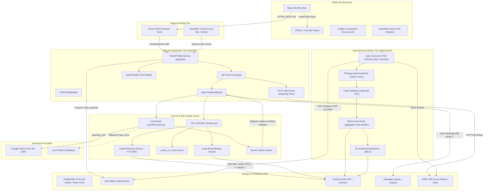

# System Architecture & Component Topology
> Purpose: Detailed architectural reference explaining the system structure, communications, boundaries, and zero-cost constraints.
> Last updated: 2026-10-29 | Status: Current
> Derived from: `apps/api/app/main.py`, `infra/docker-compose.yml`, `render.yaml`, `apps/worker/runner.py`, `core/tac.py`

## 1. High-Level Architecture Overview

AskQuiz.IQ is built on a decoupled, zero-cost-ready architecture designed to operate either locally on a developer's workstation via Docker or in the cloud using free-tier services (Vercel + Render + Neon).

### System Architecture Diagram

---

## 2. Component Register & Responsibilities

### A. Frontend Single Page Application (`apps/web`) `[VERIFIED: apps/web/src/App.tsx]`
* **Framework**: React 18 with TypeScript and Vite.
* **Responsibilities**:
  1. **Authentication**: Manages JWT storage in browser `localStorage`, handles demo credentials, and provides session logout.
  2. **Video Playback**: Coordinates playback through custom player wrappers (`Html5Player.tsx` and `YouTubePlayer.tsx`).
  3. **Temporal Synchronization**: Employs `usePlayerTime.ts` to poll HTML5 video timestamps and register pause/seek primitives.
  4. **Strict Pause & Ask Interface**: `AskBox.tsx` automatically pauses video playback upon input focus, locks the current timestamp, and visually warns the user that answers will reflect the locked moment.
  5. **Visual Spoiler Boundaries**: `UnlockBar.tsx` displays progress bars showing unlocked vs. locked material percentages.
  6. **Interactive Seeking**: Clicking on citation chips (`CitationChip.tsx`) triggers immediate player seeks to cited timestamp seconds.

### B. API Gateway & Web Service (`apps/api`) `[VERIFIED: apps/api/app/main.py]`
* **Framework**: FastAPI running under Uvicorn.
* **Responsibilities**:
  1. **Request Lifecycle**: Injects unique `X-Request-ID` UUIDs into every request context via middleware.
  2. **CORS Governance**: Enforces origins from `ALLOWED_ORIGINS` alongside dynamic regex matching for `*.vercel.app`, `*.trycloudflare.com`, and `*.onrender.com`.
  3. **Authentication**: Verifies bearer tokens and extracts `user_id` using PyJWT and bcrypt.
  4. **Range Streaming Proxy**: Handles partial content HTTP 206 requests (`apps/api/app/storage.py`), enabling instantaneous random scrubbing in large video files without downloading entire assets.
  5. **Lightweight Health & Diagnostics**: Delivers `/api/v1/health` with zero heavy ML imports to satisfy cloud platform keep-alive checks under 100MB RAM.

### C. Temporal Anchor Constraint (TAC) Engine (`core/tac.py`, `core/retrieval.py`) `[VERIFIED]`
* **Philosophy**: Protects learners against narrative and pedagogical spoilers.
* **Responsibilities**:
  1. **SQL Predicate Enforcement**: Appends `video_id = %s AND visible_from_s <= %s` to all chunk and message queries.
  2. **Exact-Word Cutting**: For speech chunks overlapping the current pause time, drops words whose timestamps occur after `pause_t`.
  3. **Recent Context Window**: Gathers the immediate preceding 60 seconds of spoken words, expanding dynamically to 180 seconds if fewer than 20 words are found.
  4. **Hard Assertion Gate**: Runs `assert_no_future(context_pack, pause_t)` before dispatching context to the LLM, throwing a critical assertion if any word or chunk exceeds `pause_t + 1e-4`.

### D. Citation Verifier & LLM Router (`core/verifier.py`, `core/llm/router.py`) `[VERIFIED]`
* **Responsibilities**:
  1. **Short ID Mapping**: Injects short identifiers (`c1`, `c2`, ...) into prompts; LLMs are prohibited from outputting timestamps or page numbers.
  2. **Hallucination Prevention**: Verifies that every cited ID existed in the retrieved context pack and that its visibility timestamp satisfies TAC.
  3. **Server Coordinate Synthesis**: Formats server-generated citation labels (e.g. `Video 01:45-02:05`, `Screen 04:12`, `PDF p.3`).
  4. **Degradation & Fallbacks**: Monitors daily LLM caps, walks fallback models (`gemini-3.5-flash-lite` -> `gemini-3.5-flash` -> `ollama`), caches responses by content hash, and degrades gracefully to retrieval-only notifications on quota exhaustion.

### E. Background Worker Pipeline (`apps/worker/`) `[VERIFIED: apps/worker/jobs.py]`
* **Architecture**: Standalone process or embedded daemon thread (`apps/worker/runner.py`) using PostgreSQL `jobs` table as an asynchronous message queue.
* **Concurrency Model**: `SELECT ... FOR UPDATE SKIP LOCKED` allows multiple workers to claim jobs without Redis or RabbitMQ.
* **Processing Stages**:
  1. `fetch`: Handles direct file storage or downloads YouTube audio/video via `yt-dlp`.
  2. `audio`: Extracts 16kHz mono WAV and generates a 720p H.264 proxy MP4 via `ffmpeg`.
  3. `transcript`: Employs `faster-whisper` (or pre-existing SRT files) to generate word-level timestamped transcripts.
  4. `chunk`: Groups words into 15–20 second overlapping chunks with `visible_from_s = end_s`.
  5. `embed`: Generates 384-dimensional dense vectors using `intfloat/multilingual-e5-small`.

---

## 3. Communication Topologies

### Topology A: Local Development & Windows Laptop Demo `[VERIFIED]`
* **PostgreSQL + pgvector**: Local Docker container listening on port `5432` / `5433`.
* **API Service**: Uvicorn listening locally on `http://127.0.0.1:8000`.
* **Worker**: Embedded worker thread inside FastAPI or separate `python -m apps.worker.runner`.
* **Frontend**: Vite dev server on `http://localhost:5173`.
* **Public Access**: Cloudflare Tunnel (`cloudflared tunnel --url http://localhost:8000`) exposes the local port securely to the public internet for remote mobile testing.

### Topology B: Zero-Cost ($0) Production Cloud Deployment `[VERIFIED: DEPLOYMENT_GUIDE.md]`
* **Frontend**: Hosted on Vercel Hobby Free Tier (Global CDN, automated edge SSL, root directory `apps/web`).
* **Backend API**: Hosted on Render Free Web Service running `infra/Dockerfile` (512MB RAM ceiling, single Uvicorn process, dynamic port binding).
* **Database**: Neon Free Serverless PostgreSQL 16 (includes `pgvector`, SSL required).
* **Memory Optimization**: `EMBEDDING_BACKEND=fts` and `EMBEDDED_WORKER=false` allow the backend to operate continuously in <120MB RAM, avoiding Render's 512MB OOM SIGKILL 137. Demo content is pre-seeded via `infra/scripts/seed_demo_data.py`.

---

## 4. Failure Modes & Degradation Hierarchy

| Failure Scenario | Component Handling | System Outcome | Confidence |
|---|---|---|---|
| **Database Connection Stale / SSL Drop** | `apps/api/app/db/session.py` (Neon keep-alive, TCP probes) | Auto-reconnects with exponential retry; endpoints retry connection | `[VERIFIED]` |
| **Render 512MB Memory Pressure** | Zero-model health check, `EMBEDDING_BACKEND=fts` | Avoids loading PyTorch / SentenceTransformer, memory stays ~100MB | `[VERIFIED]` |
| **YouTube Download Blocked / Bot Detected** | `apps/worker/stages/fetch.py` | Sets `visual_unavailable=true`, falls back to captions-only ingestion | `[VERIFIED]` |
| **Whisper OOM on Heavy Media** | `apps/worker/jobs.py` / `asr.py` | Drops to smaller model, otherwise flags job error and preserves captions | `[VERIFIED]` |
| **Gemini API Daily Cap Reached** | `core/llm/router.py` | Moves to next model in fallback chain; if exhausted, returns degraded retrieval-only answer | `[VERIFIED]` |
| **Hallucinated or Forward-Leaking Citation** | `core/verifier.py`, `core/answer.py` | Citation rejected; if all citations fail, regenerates once then downgrades to refusal | `[VERIFIED]` |
| **Unsupported / Future Question** | `core/answer.py` | Safely refuses: *"This isn't covered in the material up to mm:ss."* | `[VERIFIED]` |
